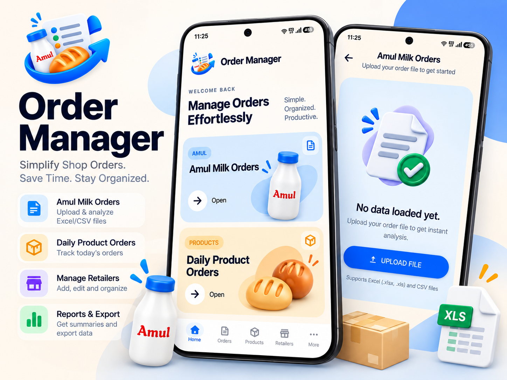
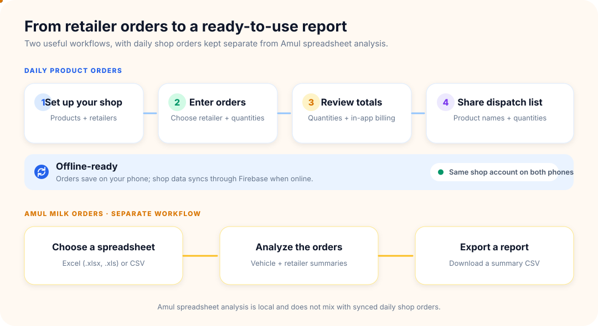
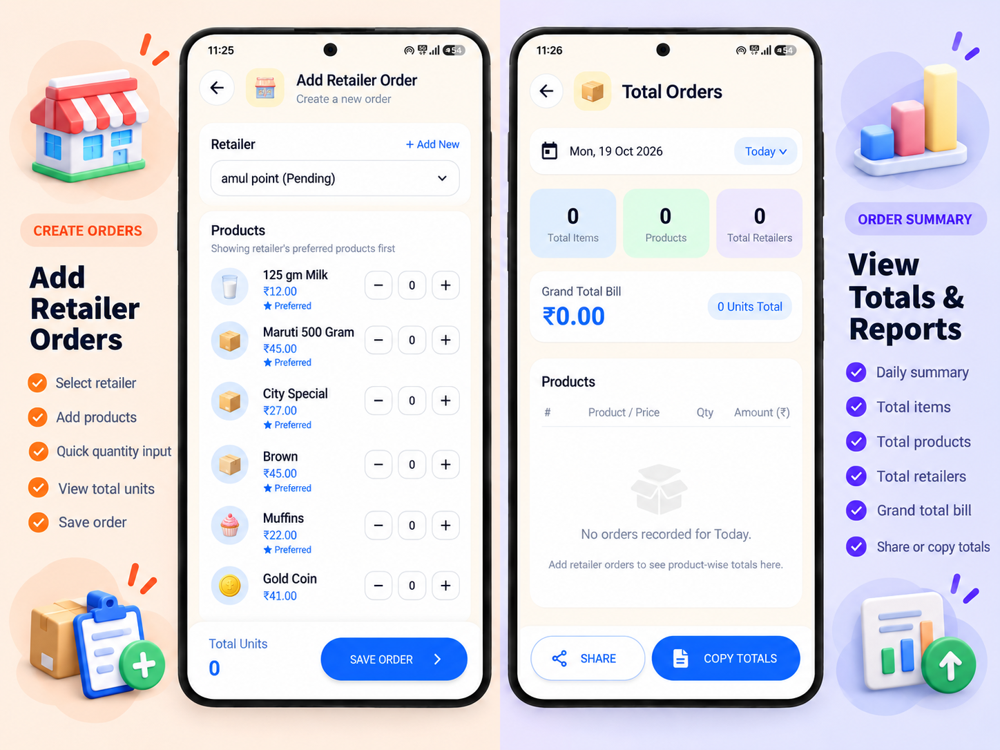
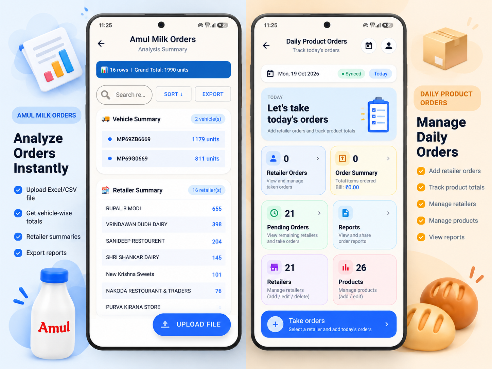
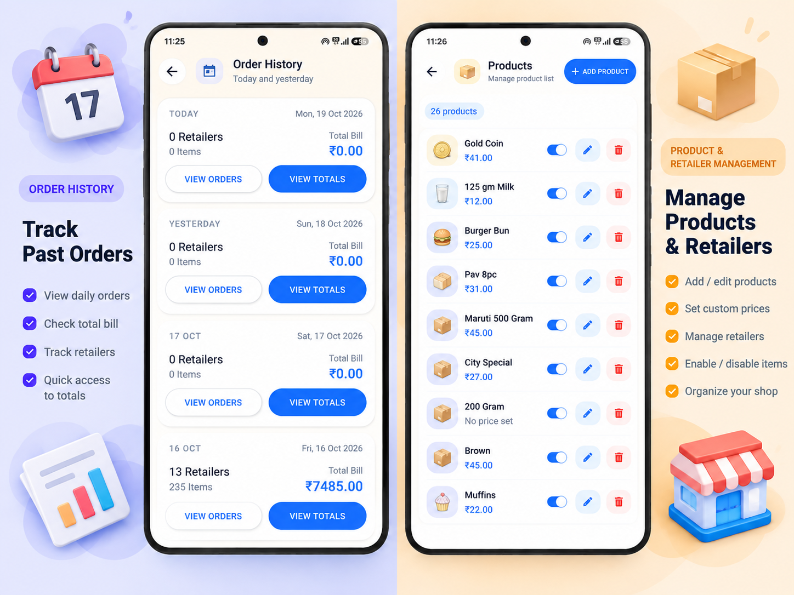
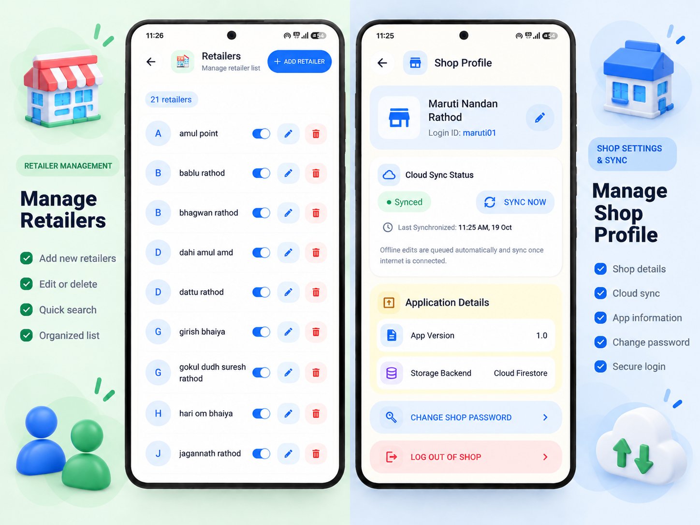

# Order Manager

[](https://gitdiagram.com/tarun-suthar-04/order-manager?utm_source=readme&utm_medium=badge)

**A simple way to take shop orders, total what you need, and keep your day organized.**

Order Manager (repository name: **Order Analyzer**) is an Android app for small shops, bakeries, and dairy businesses. Record each retailer's daily order once; the app adds up quantities across retailers so you can plan preparation and delivery without manual tallying.

It also includes a separate **Amul Milk Orders** tool for analyzing existing Excel or CSV order files. Upload a sheet to review totals by vehicle and retailer, then export a summary report.

<p align="center">
  
</p>

## See how it works

The animation below summarizes both workflows. Daily shop orders are saved on the device and can sync through Firebase; Amul spreadsheet analysis is a separate local workflow.

<p align="center">
  
</p>

## App screens

| Take orders and review totals | Dashboard and Amul analysis |
|:---:|:---:|
|  |  |

| Track history and manage products | Manage retailers and shop profile |
|:---:|:---:|
|  |  |

## What the app helps you do

| Daily Product Orders | Amul Milk Orders |
|---|---|
| Add and manage products and retailers | Upload `.xlsx`, `.xls`, or `.csv` order sheets |
| Record and update each retailer's order for the day | View totals grouped by vehicle and retailer |
| Review product quantities, bills, pending retailers, and recent history | Search and sort results, then export a CSV report |
| Copy/share a dispatch list containing product names and quantities (no prices) | Keep spreadsheet analysis separate from shop orders |

### Good to know

- Daily orders are available offline. Signed-in shop data can synchronize between devices through Firebase when a connection is available.
- Only **today's and yesterday's** daily orders are retained. Older orders are cleaned up automatically; product and retailer records are not.
- Prices and bill calculations remain available in the app. Only the copied/shared dispatch text leaves prices and amounts out.
- Amul spreadsheets are analyzed separately and are not uploaded to the shop's Firestore data.

> This repository contains the Android source code. Firebase configuration and local customer/order data are intentionally not included. Screenshots are visual examples; displayed data may be illustrative.

## Project architecture

Want a code-level view? Open the generated architecture diagram:

[](https://gitdiagram.com/tarun-suthar-04/order-manager?utm_source=readme&utm_medium=picture)

## Quick start

### You will need

- A computer with [Android Studio](https://developer.android.com/studio) installed.
- Android SDK Platform 34 (Android Studio → **Tools → SDK Manager → SDK Platforms**).
- JDK 17. Android Studio usually includes a compatible JDK; select it under **Settings → Build, Execution, Deployment → Build Tools → Gradle → Gradle JDK**.
- An Android phone with USB debugging enabled, or an Android emulator (API 26 / Android 8.0 or newer).
- For shop login and cloud sync: your own Firebase project. See [Firebase setup](#firebase-setup).

### Open and run in Android Studio

1. Clone this repository, or use **Code → Download ZIP** on GitHub and extract it.
2. In Android Studio choose **Open**, then select the extracted/cloned `Order-Analyzer` project folder (the folder containing `settings.gradle`).
3. Wait for Gradle sync to finish. If Android Studio asks to install SDK Platform 34 or accept SDK licenses, follow its prompts.
4. If you want to use Login or cloud sync, complete Firebase setup below and put `google-services.json` in `app/` before syncing/building.
5. Select the `app` run configuration and a connected device/emulator, then press **Run ▶**.

The Amul Milk Orders screen can be used without Firebase setup. Shop login and Daily Product Orders cloud sync require a configured Firebase project.

### Build from a terminal

Run these commands from the project root. On Windows PowerShell:

```powershell
./gradlew.bat assembleDebug
./gradlew.bat testDebugUnitTest
```

On macOS/Linux:

```bash
chmod +x gradlew   # first time only, if needed
./gradlew assembleDebug
./gradlew testDebugUnitTest
```

The debug APK is generated at `app/build/outputs/apk/debug/app-debug.apk`. Install it on a connected Android device with:

```bash
adb install -r app/build/outputs/apk/debug/app-debug.apk
```

## Firebase setup

Firebase is used for shop sign-in and syncing Daily Product Orders data. Configure a Firebase project you own or are authorized to use:

1. Open [Firebase Console](https://console.firebase.google.com/) and create a project (or select an existing one).
2. In the project, choose **Add app → Android**. Enter the exact Android package name `com.orderanalyzer` (also called the application ID). Register the app.
3. Download the generated `google-services.json` file and copy it to this project as `app/google-services.json` (inside the `app` folder, next to `app/build.gradle`). Do not rename it. This local project file is intentionally ignored by Git.
4. In Firebase Console, open **Build → Authentication → Get started → Sign-in method**, enable **Email/Password**, and save.
5. Open **Build → Firestore Database → Create database**. Choose the location appropriate for your users. Start in production/locked mode.
6. Open Firestore **Rules**. Review the checked-in [`firestore.rules`](firestore.rules), paste its rules into the Console editor, and click **Publish**. Do not use open rules such as `allow read, write: if true`.
7. Sync/build the Android project again and run it. Create a shop account in the app, then confirm the signed-in device shows a sync state in the profile.

The Firebase Authentication account uses a private internal email alias derived from the Login ID; the app only asks users for Login ID and password. The alias is not a real email address and cannot receive email password-reset links. The app explains its available password recovery path. Login IDs must be 3–30 characters and use letters, numbers, dots, underscores, or hyphens. Passwords must be at least six characters.

### Firestore data and access

Each shop's document ID is its Firebase Authentication UID:

```text
shops/{shopId}/profile/info
shops/{shopId}/products/{productId}
shops/{shopId}/retailers/{retailerId}
shops/{shopId}/dailyOrders/{yyyy-MM-dd}/retailers/{retailerId}
```

The checked-in Firestore rules allow an authenticated user to access only the shop path matching their UID. Products and retailers persist; daily orders are retained for today and yesterday. Test with a non-production Firebase project/account first. In particular, verify same-account sync on two devices and offline/online changes; unit tests do not exercise a live Firebase project.

## How to use the app

### Daily Product Orders

Sign in or create a shop account, then open Daily Product Orders. Set up products and retailers, enter each retailer's quantities, and use the dashboard/totals/history screens to review the day. Saving another order for the same retailer and date updates that order. Screen-level prices and billing remain available; Copy Totals and Share intentionally include quantities only.

### Amul Milk Orders

Open Amul Milk Orders and choose a spreadsheet from the device. The parser expects retailer name in column E (index 4), vehicle name in column F (index 5), and product quantities from column H (index 7) onward. The first row is treated as a header. Review/search/sort the vehicle and retailer summaries, then export a CSV if needed. See [`DATA_FORMAT.md`](DATA_FORMAT.md) for the exact import format.

## Troubleshooting

| Problem | What to check |
|---|---|
| Gradle sync says Java/JDK version is unsupported | Set Gradle JDK to JDK 17 in Android Studio settings, then sync again. |
| Android SDK/platform is missing | Install Android SDK Platform 34 in SDK Manager. |
| `google-services.json` is missing or Google Services fails | Confirm the real file is at `app/google-services.json` and the Firebase Android app is registered as `com.orderanalyzer`. |
| Login/account creation fails | Confirm Authentication → Email/Password is enabled and the device has internet access. |
| Firestore reports permission denied | Publish the included `firestore.rules` to the same Firebase project configured by `google-services.json`. |
| Amul upload finds no valid rows | Check the fixed columns: E=retailer, F=vehicle, H onward=quantities. |
| CSV export fails on an older Android phone | On Android 8–9, grant the requested storage permission. Android 10+ uses MediaStore. |

## Project details

- **Language/UI:** Java, AndroidX, Material Components
- **Storage:** SQLite locally; Firebase Authentication and Cloud Firestore for shared shop data
- **Spreadsheet parsing:** Apache POI (Excel), OpenCSV (CSV)
- **Android:** min SDK 26; compile/target SDK 34
- **Gradle:** wrapper included (Gradle 8.6, Android Gradle Plugin 8.3.2)
- **Tests:** `./gradlew testDebugUnitTest`

See [`Architecture.md`](Architecture.md) for data flow and design invariants, [`Features.md`](Features.md) for app behavior, and [`DEVELOPMENT_GUIDE.md`](DEVELOPMENT_GUIDE.md) for development and test guidance.

## Privacy and license

Do not commit `local.properties`, `app/google-services.json`, signing keys, passwords, generated build output, or the local `1773752191.csv` workbook (it may contain retailer/order data). These files are ignored by `.gitignore`. Use synthetic data for public testing.

The project is proprietary. Public availability of this repository does not grant permission to use, modify, or redistribute it. All rights reserved.
